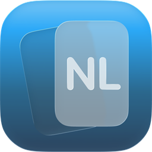

<p>
  
</p>

# Wordsbook

A borderless, macOS-flavoured vocabulary notebook for the Windows desktop.
Built with WinUI 3 and the Windows App SDK, it keeps your words, their
inflected forms, parts of speech and example sentences in one plain JSON file.

<br clear="all" />

[](https://github.com/zodfevtyn/Wordsbook/releases/latest)


## What is in the window

- **Sidebar tree** — languages, then year / month / day folders, plus a flat
  category list. Every node carries its own word count.
- **Heat map** — a GitHub-style contribution grid for the selected month, with
  working month arrows and a per-day tally.
- **Four reading modes** — list, grid, adaptive masonry cards, and a focus mode
  that hides everything but the card you are studying.
- **Adaptive cards** — each spelling variant is shown as a `FORM / NATURE` row,
  so a Dutch verb and its conjugated forms sit next to the usage note that
  explains them. Pronunciation and example sentences ride along.
- **Editor** — macOS-style date picker, wrapping category chips with a trailing
  "add" chip, and a multi-line description box.
- **Motion** — modal open/close, sidebar width, word-area transitions, search
  reveal, button hover and press feedback, and the add-card tile all animate on
  non-linear easing curves.
- **Chrome** — traffic-light buttons, rounded corners, drag-to-move, a resize
  splitter between sidebar and content, dark theme, and 1× / 1.25× / 1.5× zoom.

## Requirements

| | Prebuilt release | Building from source |
| --- | --- | --- |
| OS | Windows 10 1809 (build 17763) or later, x64 — Windows 11 tested | same |
| Runtime | none, the package is self-contained | .NET 9 SDK, Windows App SDK 2.3.1 |
| Install | unzip and run `Wordsbook.exe` | `dotnet build` |

The app is unpackaged (not MSIX), writes nothing to the registry and needs no
administrator rights. Binaries are unsigned, so Windows SmartScreen may warn on
first launch.

## Get it

Download the zip from the
[latest release](https://github.com/zodfevtyn/Wordsbook/releases/latest), create
a folder, extract **everything** (the zip root is the app folder), then start
`Wordsbook.exe`.

## Build it

```powershell
git clone https://github.com/zodfevtyn/Wordsbook.git
cd Wordsbook
dotnet build Wordsbook/Wordsbook.csproj -c Release -r win-x64 --self-contained false
```

Produce a distributable, self-contained folder and zip:

```powershell
powershell -File tools/publish.ps1
```

`tools/publish.ps1` passes `-p:EnableMsixTooling=true` on purpose. Without it a
self-contained build does not wire up the local Windows App Runtime bootstrap
and the app dies inside `Microsoft.UI.Xaml.dll` with `0xC000027B` before the
window ever appears.

## Your data

Everything lives in one human-readable file:

```
%LOCALAPPDATA%\Wordsbook\wordsbook.json
```

Words, days, languages, categories and the UI settings (theme, zoom, view mode,
sidebar width) all sit there. Copy it to move your notebook between machines.

## Notes for contributors

The sidebar width animation is the one part worth reading before touching
layout code. While the sidebar slides, `WordsHost` keeps the width it had at the
start of the animation and is counter-translated by the amount the column moved,
so the cards neither reflow nor drift and the sidebar paints over them. Only
after the sidebar reaches rest is the width released, which triggers exactly one
re-layout, and the cards then settle on their own. Without the freeze, a month
with 280+ cards costs 60–100 ms of layout per animation tick and the slide
visibly stalls; with it, a tick is 0.4–4 ms.

## License

MIT — see [LICENSE](LICENSE).
